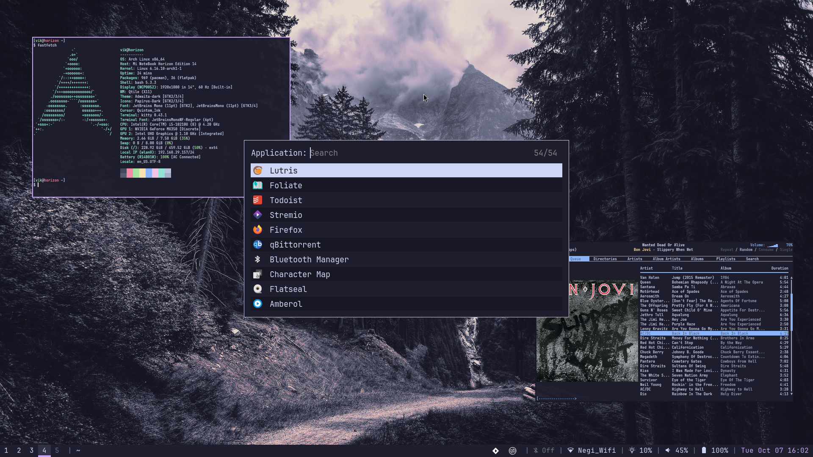

# Managing Config Files

Using GNU `stow` to manage these configuration files.

## Setup

```bash
pacman -S stow
./stow-files
```

## Examples

Here is a little preview of my system.

|                    Lockscreen                     |                       Desktop                        |
| :-----------------------------------------------: | :--------------------------------------------------: |
|  |  |

## Useful Programs

Find useful programs in the pacman directory.
